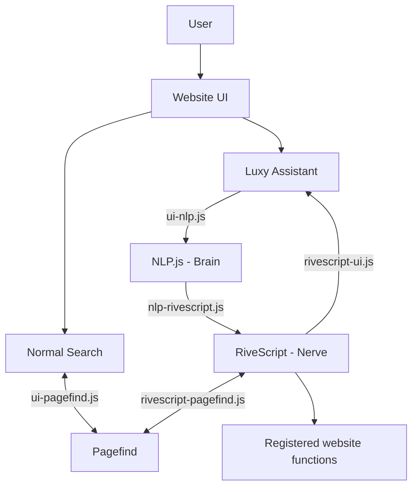

# Luxraj Search Engine — Planning Decisions

Language architecture — Three independent website versions: blog.luxraj.com/ (English, default), blog.luxraj.com/ar/ (Arabic), and blog.luxraj.com/es/ (Spanish). Manual language switching through the topbar only; no automatic detection, recommendation, redirection or preference restoration.

Phase 1 — Use three external libraries: Pagefind, RiveScript.js and NLP.js.

Phase 2 — Retain the existing search UI and styling; retire search.js, article-index.js and the empty pages/search.html, replacing the old search logic with the new engine.

Keep the existing tag system and its association files unchanged; review them separately later.

Phase 3 — Store the pinned, self-hosted browser dependencies and their licenses in site/assets/js/search-dependencies/ (pagefind/, rivescript/, nlp/); keep custom engine logic and build tools separate, with Pagefind indexes generated during the site build.

Phase 4.1 — Completed. Use Pagefind's native indexing and search features for all HTML pages, excluding its built-in UI. Maintain three independent language websites with one universal engine, shared libraries and separate language indexes. GitHub remains the working platform; each once-daily Cloudflare production deployment automatically builds all three versions and regenerates their indexes in a single Pagefind run, with no manual index maintenance.

Phase 4.2.1 — NLP.js infrastructure and communication. Load build-trained English, Arabic and Spanish models on demand in the Luxy interface and pass structured understanding through the NLP-to-RiveScript adapter.

Phase 4.2.2 — NLP.js training and automated article-based training. Combine independent foundational corpora with lightweight knowledge regenerated from the assembled site, then validate and export the three models in the GitHub build. See [Luxy NLP.js maintenance and contract](documentation/LUXY-NLP.md).

Phase 4.3.1 — Implemented. Luxy loads RiveScript.js 2.2.1 on demand. Native rules route structured NLP packets to the shared Pagefind engine and explicitly registered website functions. The response adapter delivers replies and source links to the existing Luxy composer.

Phase 4.3.2 — Implemented. English, Arabic and Spanish each handle all 28 foundational NLP intents, with clarification, search follow-ups and execution outcomes. Available destinations, indexes and controls are checked at runtime. See [Luxy RiveScript maintenance, rules and verification](documentation/LUXY-RIVESCRIPT.md).

## Workflow Architecture



**Normal Search:** The UI sends the user's query to Pagefind through `ui-pagefind.js`. Pagefind processes the query using its native search logic and returns results to the UI through the same adapter.

**Luxy Assistant:** The UI sends the user's query to NLP.js through `ui-nlp.js`. NLP.js identifies the intent, subject and requested outcome, and passes the processed information and original input to RiveScript through `nlp-rivescript.js`. RiveScript follows the predefined intent-based rules to respond, search Pagefind through `rivescript-pagefind.js`, or execute an authorized JavaScript function. Pagefind results return to RiveScript through the same adapter. RiveScript sends the final response directly to the UI through `rivescript-ui.js`, without NLP reprocessing.

**Adapters:** Communication only; no independent decision-making or execution logic. No central controller. Tag Search remains untouched.

## File and Directory Structure

```text
Luxraj-Blog/
├── README.md
├── SEARCH-ENGINE-PLANNING.md
├── search-dependencies/
│   ├── pagefind/
│   ├── rivescript/
│   └── nlp/
└── site/
    └── assets/
        └── js/
            ├── search-dependencies/
            │   ├── pagefind/
            │   ├── rivescript/
            │   └── nlp/
            └── adapter/
                └── search-adapters/
                    ├── ui-pagefind.js
                    ├── ui-nlp.js
                    ├── nlp-rivescript.js
                    ├── rivescript-pagefind.js
                    └── rivescript-ui.js
```

Preserve the original external libraries and their licenses in the root-level `search-dependencies/` directory. Store browser-compatible working copies in `site/assets/js/search-dependencies/`, and all five communication adapters in `site/assets/js/adapter/search-adapters/`.
