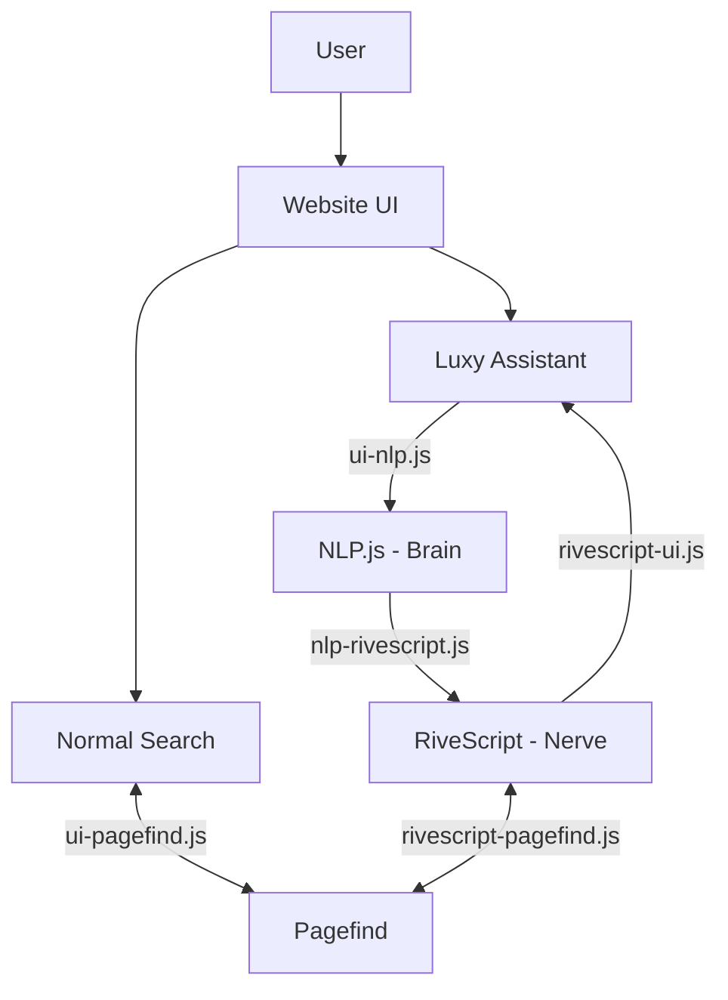

# Luxraj Search Engine — Planning Decisions

Language architecture — Three independent website versions: blog.luxraj.com/ (English, default), blog.luxraj.com/ar/ (Arabic), and blog.luxraj.com/es/ (Spanish). Manual language switching through the topbar only; no automatic detection, recommendation, redirection or preference restoration.

Phase 1 — Use three external libraries: Pagefind, RiveScript.js and NLP.js.

Phase 2 — Retain the existing search UI and styling; retire search.js, article-index.js and the empty pages/search.html, replacing the old search logic with the new engine.

Keep the existing tag system and its association files unchanged; review them separately later.

Phase 3 — Store the pinned, self-hosted browser dependencies and their licenses in site/assets/js/search-dependencies/ (pagefind/, rivescript/, nlp/); keep custom engine logic and build tools separate, with Pagefind indexes generated during the site build.

Phase 4.1 — Use Pagefind's native indexing and search features for all HTML pages, excluding its built-in UI. Maintain three independent language websites with one universal engine, shared libraries and separate language indexes. GitHub remains the working platform; each once-daily Cloudflare production deployment automatically builds all three versions and regenerates their indexes in a single Pagefind run, with no manual index maintenance.

Phase 4.2.1 — RiveScript execution and communication: Retain the original interpreter and connect it to Pagefind and authorized website controls through explicitly registered custom JavaScript functions; prevent arbitrary JavaScript execution from user input.

Phase 4.2.2 — RiveScript rule setting: Develop our own language-specific conversation rules for English, Arabic and Spanish, gradually utilizing all native RiveScript features in a controlled manner.

Phase 4.3.1 — NLP.js infrastructure: Set up training, model loading, execution and communication, using minimal sample data to verify functionality.

Phase 4.3.2 — NLP.js training: Prepare English, Arabic and Spanish training data, train and save the models, and test intent recognition.

## Workflow Architecture



**Normal Search:** The UI sends the user's query to Pagefind through `ui-pagefind.js`. Pagefind processes the query using its native search logic and returns results to the UI through the same adapter.

**Luxy Assistant:** The UI sends the user's query to NLP.js through `ui-nlp.js`. NLP.js identifies the intent, subject and requested outcome, and passes the processed information and original input to RiveScript through `nlp-rivescript.js`. RiveScript follows the predefined intent-based rules to respond, search Pagefind through `rivescript-pagefind.js`, or execute an authorized JavaScript function. Pagefind results return to RiveScript through the same adapter. RiveScript sends the final response directly to the UI through `rivescript-ui.js`, without NLP reprocessing.

**Adapters:** Communication only; no independent decision-making or execution logic. No central controller. Tag Search remains untouched.

## File and Directory Structure

```text
Luxraj-Blog/
├── README.md
├── SEARCH-ENGINE-PLANNING.md
├── search-dependencies/
│   ├── pagefind/
│   ├── rivescript/
│   └── nlp/
└── site/
    └── assets/
        └── js/
            ├── search-dependencies/
            │   ├── pagefind/
            │   ├── rivescript/
            │   └── nlp/
            └── adapter/
                └── search-adapters/
                    ├── ui-pagefind.js
                    ├── ui-nlp.js
                    ├── nlp-rivescript.js
                    ├── rivescript-pagefind.js
                    └── rivescript-ui.js
```

Preserve the original external libraries and their licenses in the root-level `search-dependencies/` directory. Store browser-compatible working copies in `site/assets/js/search-dependencies/`, and all five communication adapters in `site/assets/js/adapter/search-adapters/`.

## Normal Search UI

Retain the Luxraj design and consume Pagefind's native API and data directly through `ui-pagefind.js`. Support highlighted excerpts, images, section links, dynamic indexed filters, result counts, progressive loading, keyboard navigation, and search states. Use native relevance ordering; remove the legacy reading-time, date and alphabetical controls until supported by indexed fields. Keep the legacy article index and shared Tag Search renderer for Tag Search only. Build the pinned Pagefind 1.6.0 browser bundle and index after assembling the site. The complete offline library backup remains pending.
